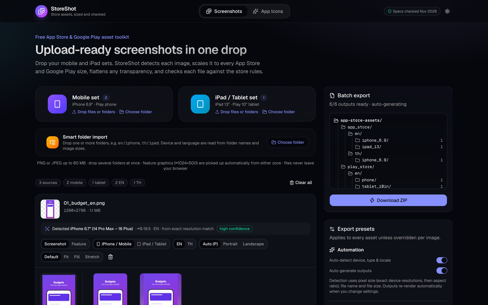
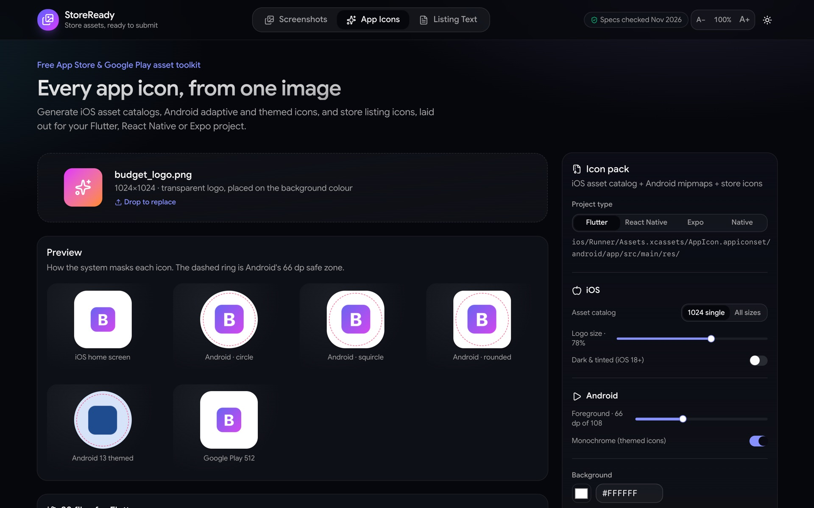

# StoreReady · App Store & Google Play screenshots, app icons and listing text, ready to submit

**Live:** https://aravi365.github.io/storeready/

Free, private, in-browser tool that resizes App Store and Google Play screenshots to every required size, strips the alpha channel, checks each file against the store rules, and packages everything into a ready-to-upload ZIP. It also generates iOS and Android app icons for Flutter, React Native and Expo projects. Nothing is uploaded: all processing happens in your browser.





## Features
- **Every 2026 store size:** iPhone 6.9″ (1320×2868) and the required 6.3″ (1206×2622), iPhone Duo foldable (outer 1398×2034 and inner 2007×2853), iPad 13″ (2064×2752), Google Play phone, 7″ and 10″ tablet, Android XR (3840×2400, 8:5), and the 1024×500 feature graphic, in portrait or landscape.
- **Every App Store and Google Play language:** all 50 App Store Connect localizations, detected from folder/file names for screenshots and from pasted text in Listing Text. ZIP and fastlane folders use each store's own locale codes (`ja` / `ja-JP`, `zh-Hans` / `zh-CN`…).
- **Upload files or whole folders:** drop into the Mobile, iPad / Tablet, iPhone Duo or Android XR set, or use **Smart folder import** with a tree like `en/iphone`, `th/ipad`. You can drop several folders at once, or pick them one after another. Hidden and non-image files are skipped.
- **Auto-detection:** device from the exact pixel size (about 30 known iPhone, iPad and Android resolutions), then aspect ratio; language (any of the 50 App Store languages) and type from file and folder names; warnings for oversized or low-resolution sources.
- **Store-compliant output:** true 24-bit RGB PNG (no alpha) or JPEG, a size cap for Google Play, and a compliance badge on every file.
- **Edge extension (default Fit):** never crops and never adds bars. The canvas grows by continuing the screenshot's own background from its plainest edge (outermost rows averaged, lightly blurred, with a short feathered blend), and every output gets automatic checks: seam brightness, no black lines, nothing cropped, no transparency. Override the side per image (top, bottom, both, left, right). Blurred and solid letterbox, Fill (smart crop) and Stretch are still available.
- **Custom sizes and file names:** add any W×H; outputs keep the original file name with a size suffix (or plain names, or numbered).
- **Auto-generated outputs** with a table of every file, and one ZIP sorted by store, language and device.
- **Store Preview tab:** your screenshots, icon and listing text on App Store and Google Play product pages, in iPhone, iPad, Android phone and Android tablet frames, light or dark, per language (ratings and downloads are placeholders).
- **Full-size preview popup** for any generated file (100% zoom, arrow-key browsing, compliance details, download).
- **Remove individual outputs:** drop one size for one image (e.g. keep iPad 13″, skip Play 10″ tablet) with Undo and Restore.
- **Android tablets optional:** one switch skips all Google Play tablet sizes (phone screenshots alone are enough to publish).
- **Listing Text checker:** paste your App Store and Google Play name, subtitle, descriptions and keywords; every line is checked against Apple's App Review Guidelines (e.g. 2.3.10 no Android/Google Play mentions, 2.3.7 no prices or "#1" claims) and Google Play's metadata policy (no emoji or ranking terms in titles), with one-click fixes, Undo, and a fastlane metadata export.
- **Adjustable text size** next to the light/dark toggle, remembered between visits.
- **App icon generator:** iOS `AppIcon.appiconset`, Android legacy, round, adaptive and Android 13 themed icons, plus the App Store 1024 and Google Play 512 store icons.

## Run locally
```bash
npm install
npm run dev      # http://localhost:3000
npm run build && npm start
npm test         # unit tests (Vitest)
```

## How it works
1. Drop PNG/JPEG files or folders (up to 60 MB, 12000 px a side). The app detects the device, language and type for each image; you can change any of them per image.
2. Pick stores, presets, locales, scaling (Fit / Fill (smart crop) / Stretch), letterbox fill (blurred or solid), matte colour and format in **Export presets**.
3. Outputs render automatically in a Web Worker. Live previews show each target next to the original, with a compliance badge (click it to see the checks).
4. **Download ZIP** saves `app-store-assets-YYYY-MM-DD.zip`. A `manifest.json` inside lists the compliance results.

## Key files
| File | Purpose |
|---|---|
| `utils/presets.ts` | Store presets, the verified rules and their sources, the compliance evaluator |
| `utils/detect.ts` | Device / type / language detection from pixel size, file and folder names, and file size |
| `utils/canvasResizer.ts` | Decode, alpha/focal analysis, fit/fill/stretch composition, blur backdrop, step-down downscale, encoding with size cap |
| `utils/pngEncoder.ts` | True 24-bit RGB PNG encoder (canvas `toBlob` always writes RGBA, which Apple rejects) |
| `utils/zipExporter.ts` | JSZip folder layout + manifest + download |
| `utils/jobs.ts` / `utils/renderClient.ts` / `workers/render.worker.ts` | Job planning and off-main-thread rendering (falls back to the main thread) |
| `utils/iconGenerator.ts` | iOS / Android / store icon rendering and project layouts |
| `components/ImageUploader.tsx` | Upload sets, folder import, per-asset controls, live preview tiles |
| `components/ScreenshotStudio.tsx` | Auto-generate pipeline, export, progress, folder-tree preview |
| `components/IconGenerator.tsx` | App icon tab |
| `components/SeoGuide.tsx` | Size guide and FAQ shown below the tool |

## App icons
The **App Icons** tab turns one 1024×1024 image into:
- iOS `AppIcon.appiconset` (single 1024 size for Xcode 14+, or every legacy size), opaque 24-bit PNGs, optional iOS 18 dark/tinted
- Android `mipmap-*dpi` legacy + round icons, adaptive foreground (108 dp, 66 dp safe zone), monochrome themed icon, `ic_launcher.xml`, background colour resource
- Store icons: App Store 1024 and Google Play 512
- Laid out for Flutter, React Native (`ios/<App>/Images.xcassets`), Expo (`assets/images` + `app.json` snippet) or plain native projects
